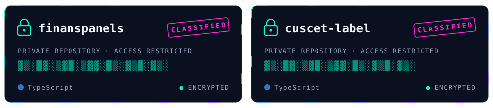
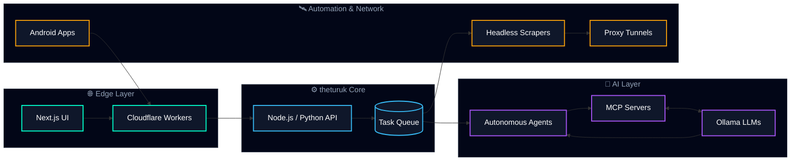

<!-- ═══════════════════════ HEADER ═══════════════════════ -->

 

  

🟢 &nbsp;Freelance & iş birliklerine açık &nbsp;·&nbsp; ⚡ Otomasyon &nbsp;·&nbsp; 🧠 AI Ajanları &nbsp;·&nbsp; 🌐 Ölçeklenebilir Web

### ⚡ `whoami` // Sistem Profili

  

### 🚀 `what_i_build` // Neler İnşa Ediyorum

<table width="100%">
  <tr>
    <td width="50%" valign="top">
      <h3>🛡️ Stealth Scraping Engine</h3>
      Headless tarayıcılar, fingerprint yönetimi, rotating proxy ağları ve dağıtık görev kuyruklarıyla ölçeklenen veri toplama sistemleri.
        
      
      
      
      
    </td>
    <td width="50%" valign="top">
      <h3>🧠 AI Agents & MCP</h3>
      Lokal LLM'ler üzerinde çalışan otonom ajanlar, özel MCP sunucuları ve uçtan uca iş akışı otomasyonu — buluta bağımlı olmadan.
        
      
      
      
      
    </td>
  </tr>
  <tr>
    <td width="50%" valign="top">
      <h3>🌐 High-Conversion Web</h3>
      Next.js ve TypeScript ile hızlı, SEO dostu, dönüşüm odaklı e-ticaret ve SaaS arayüzleri; edge üzerinde çalışan API'ler.
        
      
      
      
      
    </td>
    <td width="50%" valign="top">
      <h3>📡 Mobile & Network</h3>
      Native Android uygulamaları, özel proxy/tunnel protokolleri ve Cloudflare Workers üzerinde çalışan ağ araçları.
        
      
      
      
      
    </td>
  </tr>
</table>

### 🛠️ `tech_stack` // Arsenal

  
   
  

### 🗂️ `featured_projects` // Öne Çıkan Projeler

  
   
  🔒 Aktif projeler şu an private — erişim için iletişime geç.

### 🧬 `architecture` // Sistem Mimarisi

### 📊 `telemetry` // GitHub İstatistikleri

  

   

  

    

  <!-- 3D katkı grafiği: .github/workflows/profile-3d.yml tarafından her gün üretilir -->
  <picture>
    <source media="(prefers-color-scheme: dark)" srcset="https://raw.githubusercontent.com/theturuk/theturuk/main/profile-3d-contrib/profile-night-rainbow.svg" />
    <source media="(prefers-color-scheme: light)" srcset="https://raw.githubusercontent.com/theturuk/theturuk/main/profile-3d-contrib/profile-gitblock.svg" />
    
  </picture>

### 🐍 `contribution_snake` // Katkı Grafiğimi Yiyen Yılan

  <!-- .github/workflows/snake.yml tarafından 12 saatte bir üretilir -->
  <picture>
    <source media="(prefers-color-scheme: dark)" srcset="https://raw.githubusercontent.com/theturuk/theturuk/output/github-snake-dark.svg" />
    <source media="(prefers-color-scheme: light)" srcset="https://raw.githubusercontent.com/theturuk/theturuk/output/github-snake.svg" />
    
  </picture>

### 🤝 `connect` // İletişim

Yeni nesil otomasyon sistemleri, AI ajanları, özel ağ çözümleri ya da ölçeklenebilir web projeleri üzerine konuşalım.

&nbsp;

  

⭐ Bir projemi beğendiysen yıldız bırakmayı unutma — sistem moral yükleniyor...

