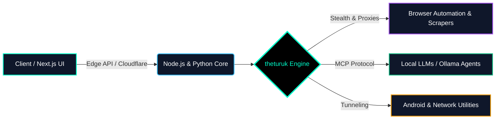

<div align="center">

  <!-- DYNAMIC ANIMATED HEADER -->
  

  <!-- ANIMATED TYPING SVG (SINGLE LINE TERMINAL EFFECT - FIXED OVERFLOW) -->
  <a href="https://github.com/theturuk">
    
  </a>

  <br/><br/>

  <!-- SOCIAL & PROFILE BADGES -->
  <p align="center">
    <a href="https://www.linkedin.com/in/theturuk/" target="_blank">
      
    </a>
    <a href="https://www.instagram.com/theturuk/" target="_blank">
      
    </a>
    <a href="https://github.com/theturuk" target="_blank">
      
    </a>
    
  </p>

</div>

---

### ⚡ `whoami` // Sistem Mimarisi & Profil

```yaml
root@theturuk-system:~# cat profile_manifest.yaml

developer:
  name: "Fatih"
  handle: "@theturuk"
  alias: "vx0r"
  role: "Full-Stack Developer & Automation Architect"
  status: "Building stealth scrapers, AI agents & scalable web architectures"

core_domains:
  web_frontend: 
    - "Next.js & React Ecosystem"
    - "TypeScript & Tailwind CSS"
    - "Modern E-Commerce & High-Conversion Architectures"
  backend_automation: 
    - "Node.js & Python High-Concurrency Backends"
    - "Custom Headless Scrapers & Anti-Bot Bypass Systems"
    - "Browser Automation & Distributed Task Queues"
  ai_and_tooling: 
    - "Local LLMs Deployment (Ollama)"
    - "Model Context Protocol (MCP) Servers"
    - "Autonomous AI Coding Agents & Workflow Integration"
  mobile_and_network: 
    - "Native & Cross-Platform Android Development"
    - "Custom Proxy/Tunneling Protocols & Network Utilities"
```

---

### 🛠️ `tech_stack` // Arsenal & Teknolojiler

<div align="center">

  <!-- ANIMATED SKILL ICONS -->
  <p align="center">
    
  </p>

  <!-- DETAILED CATEGORIZED MATRIX -->
  <table width="100%">
    <thead>
      <tr>
        <th width="25%">🌐 Web & Frontend</th>
        <th width="25%">⚙️ Backend & Automation</th>
        <th width="25%">🧠 AI & Next-Gen Tooling</th>
        <th width="25%">📡 Mobile & Network</th>
      </tr>
    </thead>
    <tbody>
      <tr>
        <td align="center" valign="top">
          <br/>
          <br/>
          <br/>
          <br/>
          
        </td>
        <td align="center" valign="top">
          <br/>
          <br/>
          <br/>
          <br/>
          
        </td>
        <td align="center" valign="top">
          <br/>
          <br/>
          <br/>
          <br/>
          
        </td>
        <td align="center" valign="top">
          <br/>
          <br/>
          <br/>
          <br/>
          
        </td>
      </tr>
    </tbody>
  </table>

</div>

---

### 🧬 `architecture_focus` // Neler İnşa Ediyorum?



---

### 📊 `telemetry` // GitHub İstatistikleri & Aktivite

<div align="center">
  
  <!-- SIDE BY SIDE STATS CARDS -->
  <a href="https://github.com/theturuk">
    
  </a>
  <a href="https://github.com/theturuk">
    
  </a>

  <br/><br/>

  <!-- GITHUB TROPHIES (REPLACED BROKEN ACTIVITY GRAPH) -->
  <a href="https://github.com/theturuk">
    
  </a>

</div>

---

<div align="center">

  ### 🤝 `connect` // İletişim & Sosyal Ağlar

  <p>Yeni nesil otomasyon sistemleri, AI ajanları, özel ağ çözümleri veya ölçeklenebilir web projeleri üzerine konuşmak için bağlantı kurabilirsin:</p>

  <a href="https://www.linkedin.com/in/theturuk/" target="_blank">
    
  </a>
  &nbsp;&nbsp;
  <a href="https://www.instagram.com/theturuk/" target="_blank">
    
  </a>

  <!-- ANIMATED FOOTER -->
  

</div>
